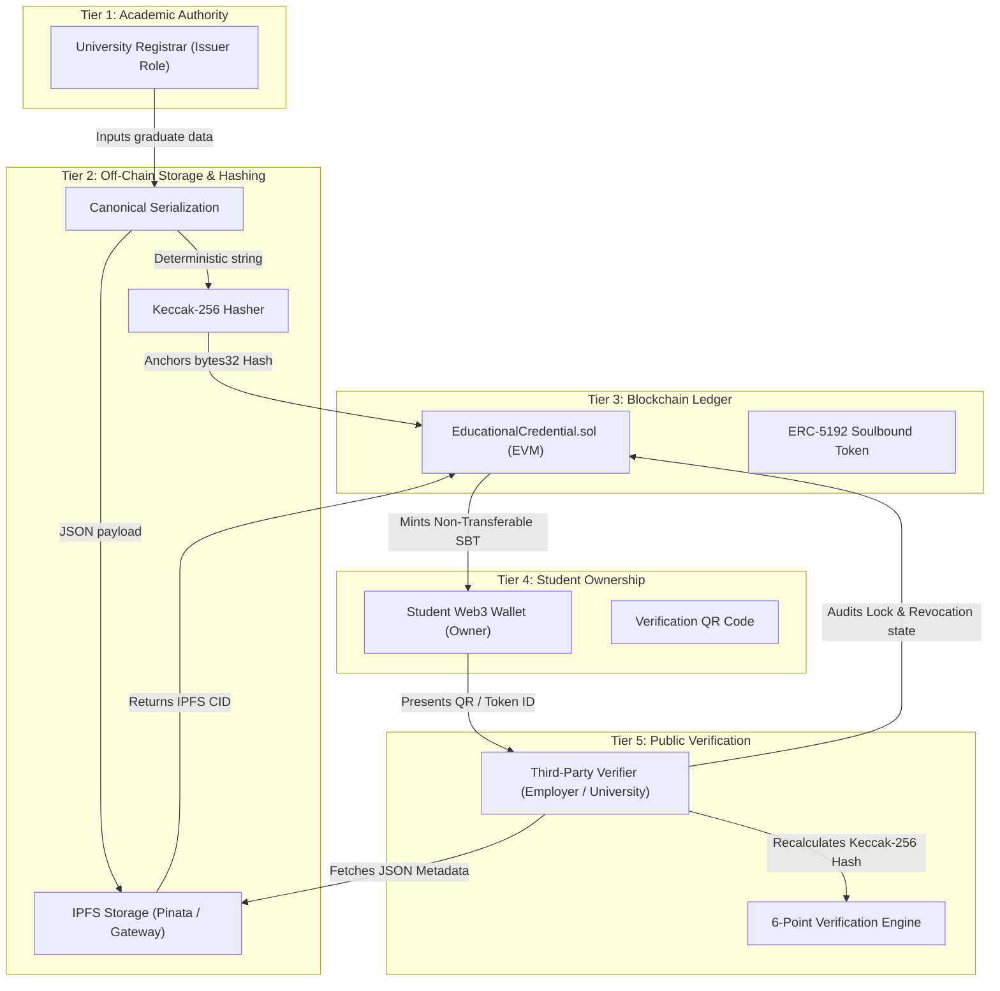

# System Architecture & Technical Specification

## Project Title
**Cryptographically Anchored Educational Credentials: A Decentralized Framework for SDG 4 Quality Education**

---

## 1. High-Level Architecture Overview

The EduSoulbound platform is structured around three distinct participant tiers and an immutable decentralized storage/ledger backbone:



---

## 2. Privacy-by-Design Data Separation

In accordance with global privacy principles (and guidelines such as GDPR & FERPA), personal student data is strictly segregated from public blockchain state:

| Data Element | Storage Location | Visibility | Immutability |
| :--- | :--- | :--- | :--- |
| **Full Student Name** | IPFS Metadata JSON | Controlled via Gateway / URI | Pinned / Decentralized |
| **Student ID Number** | IPFS Metadata JSON | Controlled via Gateway / URI | Pinned / Decentralized |
| **Degree & Major** | IPFS Metadata JSON | Public Verifier Access | Pinned / Decentralized |
| **Conferral Date** | IPFS Metadata JSON | Public Verifier Access | Pinned / Decentralized |
| **Student Wallet Address** | Smart Contract & IPFS | Public Ledger | Immutable |
| **Keccak-256 Credential Hash** | Smart Contract Ledger | Public Ledger | Immutable |
| **IPFS Metadata URI** | Smart Contract Ledger | Public Ledger | Immutable |
| **ERC-5192 Lock State** | Smart Contract Ledger | Public Ledger | Permanent (`true`) |
| **Revocation Status & Reason**| Smart Contract Ledger | Public Ledger | State Update |

---

## 3. Credential Lifecycle Workflows

### 3.1 Issuance Flow
1. **Registrar Authentication**: The registrar connects an EVM wallet. The smart contract validates `hasRole(ISSUER_ROLE, msg.sender)`.
2. **Canonical Serialization**: Student and degree attributes are normalized into a standardized delimiter-separated format:
   ```text
   studentId|studentAddress|degreeTitle|major|institution|graduationDate|credentialType
   ```
3. **Cryptographic Hashing**: Keccak-256 is executed over the UTF-8 bytes of the canonical string, generating an immutable 32-byte fingerprint `H_doc`.
4. **IPFS Pinning**: The complete metadata JSON document is pinned to IPFS, returning an IPFS Content Identifier (CID).
5. **On-Chain Soulbound Minting**: The registrar executes `safeMintSBT(studentAddress, ipfsURI, credentialHash)`.
6. **Soulbound Lock**: The smart contract assigns ownership to the student, records the hash and URI, marks the token as permanently locked, and emits the ERC-5192 `Locked(tokenId)` event.

### 3.2 Verification Flow
1. **Verifier Query**: The verifier provides the Token ID and optional expected student address.
2. **Ledger Lookup**: The portal queries the contract for:
   - `ownerOf(tokenId)`: Confirms token existence and student ownership.
   - `locked(tokenId)`: Confirms the credential is an ERC-5192 Soulbound token (`true`).
   - `isRevoked(tokenId)`: Confirms whether the university has revoked the degree (`false`).
   - `getCredential(tokenId)`: Retrieves on-chain hash and IPFS URI.
3. **Metadata Resolution**: The portal fetches off-chain metadata from the IPFS gateway.
4. **Cryptographic Hash Recomputation**: The portal independently serializes the fetched metadata into canonical format and executes Keccak-256.
5. **Comparison**: If `computedHash == onChainHash`, authenticity is cryptographically proven.

### 3.3 Revocation Flow
1. **Trigger**: Academic misconduct, clerical error, or degree nullification.
2. **Execution**: Authorized issuer calls `revokeCredential(tokenId, reason)`.
3. **Audit Trail**: The transaction does not burn or erase the token; it sets `_revokedTokens[tokenId] = true` and records the revocation reason on-chain.
4. **Result**: Subsequent verifier queries immediately reflect `⚠ CREDENTIAL REVOKED`.
